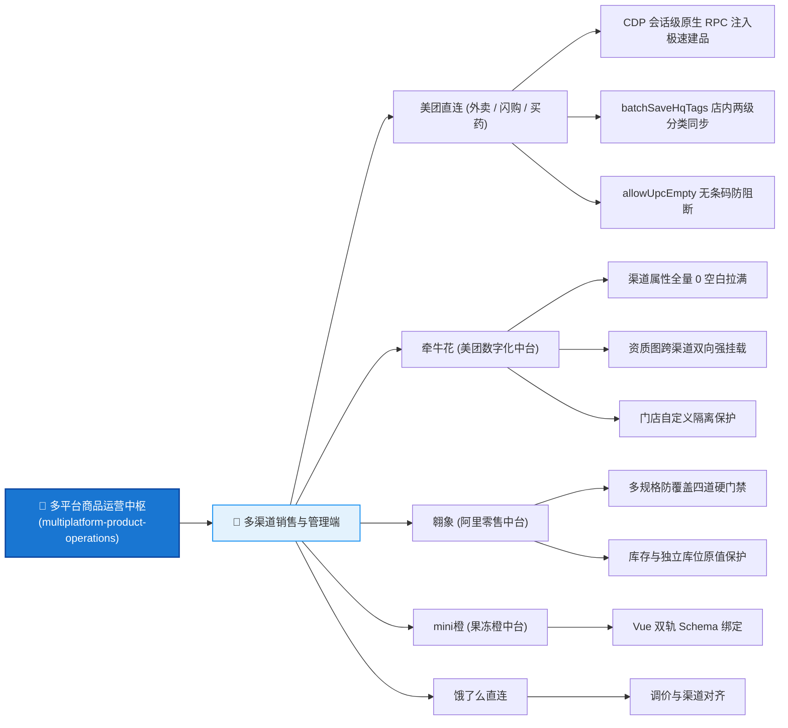

# 多平台商品运营自动化 Skill (multiplatform-product-operations)

[](VERSION)
[](#一全景平台矩阵与能力分布)
[](#二三级按需加载架构)

本仓库是专为即时零售闪电仓打造的**多平台商品运营与渠道治理自动化中枢（AI Skill）**。  
实现了多销售渠道一键建品、渠道属性治理、资质图双向挂载与价格管控的全链路标准化闭环。

---

## 📌 快速导航
- [一、 全景平台矩阵与能力分布](#一-全景平台矩阵与能力分布)
- [二、 三级按需加载架构](#二-三级按需加载架构)
- [三、 核心业务能力与深度合同速查](#三-核心业务能力与深度合同速查)
- [四、 目录工程结构图](#四-目录工程结构图)
- [五、 团队协作与同步更新规范（必读）](#五-团队协作与同步更新规范必读)
- [六、 上游生图接口与证照提示词](#六-上游生图接口与证照提示词)

---

## 一、 全景平台矩阵与能力分布



---

## 二、 三级按需加载架构

为彻底杜绝跨平台规则串用、字典混淆或遗漏平台专属防风控红线，本 Skill 严格按**金字塔三级按需路由**执行：

1. **第 0 层：顶层入口（[`SKILL.md`](SKILL.md)）**：跨平台共享通用铁律（首单金丝雀回读、门店自定义隔离、原值保护）；
2. **第 1 层：平台适配器（`references/platforms/{platform}.md`）**：冻结当前平台专属网络环境、登录态、加签要求与防风控红线；
3. **第 2 层：任务能力分支（`references/tasks/{task}.md`）**：锁定当次任务字段规范与业务逻辑；
4. **第 3 层：深度实战规程（`detail_references`）**：按需仅加载当前平台×当前能力的底层执行细节。

---

## 三、 核心业务能力与深度合同速查

| 平台板块 | 对应业务场景 | 核心执行机制与避坑点 | 对应规范合同文件 |
| :--- | :--- | :--- | :--- |
| **美团直连 (`meituan`)** | 美团外卖/闪购不可售与影响流量治理、误判申诉、全店极速建品与整店清空 | • **CDP 原生 RPC 注入**：免受控 Chrome 端口依附，在 `#hashframe` / 经典审核页调用原生模块，0 滑块 0 封控；<br>• **商品管家全队列治理**：覆盖 `effectType: 1+5+6`（无法售卖）、`2`（影响流量）与 `7`（审核中异步对账），支持 `effectType: 6` 禁售词误杀原生 API 自动申诉；<br>• **两阶段建品与逆序清店**：建品先调 `batchSaveHqTags` 再调 `uniSave`（无条码配 `allowUpcEmpty: "true"`）；清店先 `batchDeleteWithSpu` 清商品，再按“先二级子分类 ➔ 后一级主分类”逆序调 `_R(type: 2)` 归零分类树。 | [`references/platform-meituan.md`](references/platform-meituan.md)<br>[`references/meituan-product-editing.md`](references/meituan-product-editing.md)<br>[`references/platforms/meituan.md`](references/platforms/meituan.md) |
| **牵牛花 (`qnh`)** | 渠道属性治理、资质图、不可售激活 | • **0 空白全量属性**：四级物化梯队（官方推荐第一优先，真实品牌原值保护）；<br>• **多规格京东到家销售属性与全规格关联**：对 `specType === 2` 多规格商品自动拉取 `jdSaleAttrList`，默认选第 1 个销售属性（如 `颜色`/`尺码`/`规格`）并将全部 SKU 规格值一一关联写入 `sci300.saleAttrValueList`，彻底消除 `请至少选择1项` 无法推送京东到家问题；<br>• **特殊图双向强对齐**：美团 Type 5（配料表图）与饿了么 Type 8（背签图）双向强制挂载；<br>• **门店自定义隔离**：严禁传 `coverToStore: 1` 抹平门店独立改名与主图。 | [`references/channel-attribute-contract-v2.md`](references/channel-attribute-contract-v2.md)<br>[`references/qualification-image-policy.md`](references/qualification-image-policy.md)<br>[`references/upstream-image-generation.md`](references/upstream-image-generation.md)<br>[`references/platforms/qnh.md`](references/platforms/qnh.md) |
| **翱象 (`aoxiang`)** | 阿里天猫闪购渠道属性与商品编辑 | • **多规格防覆盖四道门禁**：无条件调 `relation/detail`，执行 `assertMultiSpecSafe` 断言，严密保护门店子规格库存与独立库位。 | [`references/platforms/aoxiang-playbook-and-pitfalls.md`](references/platforms/aoxiang-playbook-and-pitfalls.md) |
| **mini橙 (`minicheng`)** | 果冻橙中台全量属性治理 | • **Vue 双轨绑定**：美团与饿了么渠道属性结构解耦，销售单位规范补齐。 | [`references/platforms/minicheng-playbook-and-pitfalls.md`](references/platforms/minicheng-playbook-and-pitfalls.md) |

---

## 四、 目录工程结构图

```
multiplatform-product-operations/
├── README.md                                          # 📖 仓库核心导览与知识大图（本文档）
├── SKILL.md                                           # 🧭 Skill 顶层路由入口与通用铁律
├── package.json                                       # 项目版本与脚本声明
├── quick_validate.py                                  # 本地规范完整性自检脚本
├── references/                                        # 📚 知识规程与深度业务合同
│   ├── platforms/                                     # 🏢 平台专属入口与 Playbook
│   │   ├── meituan.md                                 # 美团直连入口
│   │   ├── qnh.md                                     # 牵牛花中台入口
│   │   ├── aoxiang.md / aoxiang-playbook-and-pitfalls # 翱象中台入口与防坑规程
│   │   ├── minicheng.md / minicheng-playbook-and-pitfalls # mini橙入口与规程
│   │   └── eleme.md / taobao-flash.md                 # 饿了么 / 淘宝闪购入口
│   ├── tasks/                                         # ⚙️ 任务能力规范
│   │   ├── product-editing.md                         # 商品编辑
│   │   ├── channel-attributes.md                      # 渠道属性治理
│   │   ├── qualification-images.md                    # 资质图挂载
│   │   └── medical-device-store-migration.md          # 医疗器械整店迁移
│   ├── upstream-image-generation.md                   # ★ 上游生图接口、key 与分证照提示词
│   └── meituan-product-editing.md                     # ★ 美团 uniSave 极速建品深度合同
└── scripts/                                           # 🛠️ 自动化执行脚本与工具库
    ├── route_skill.py                                 # 三级加载动态路由脚本
    ├── start_test_browser.sh                          # 免受控 Chrome 启动助手
    └── ...
```

---

## 五、 团队协作与同步更新规范（必读）

为保证知识库长效稳定、团队多会话协作不丢失上下文，所有协作者必须严格遵守以下规范：

1. **谁更新代码/规则，谁同步更新 `README.md`**：
   - 凡新增平台、新增任务能力、或对既有风控参数（如新版滑块、新接口字段）发生变更时，**必须在同一个 Commit 中更新本 `README.md` 的对应速查表与导航**；
   - 严禁“只改代码不写文档”或“文档与代码脱节”。
2. **渐进迭代不随意推翻已有合同**：
   - 修改前必须核对既有合同版本；对于平台新增字段，遵循向后兼容与默认安全值兜底原则；
   - 绝不随意重命名成熟核心合同文件（如 `meituan-product-editing.md`），以防破坏其他 Agent 的软链接索引。
3. **提交口径与版本号自增**：
   - 每次完成功能性扩充或重大修正确认后，适度递增 [`VERSION`](VERSION) 文件版本号；
   - Commit Message 遵循语义化前缀：`feat:`、`fix:`、`docs:`、`refactor:`。

---

## 六、 上游生图接口与证照提示词

资质图/专项图**允许并优先通过上游生图 API 生成**（含 3C 认证证书、医疗器械注册证/备案凭证等证照类图片），
生成图上传确权后写回平台；不再设置真实材料前置门槛，同 SPU 已有可复用图也不再是发起生图的前置门槛。

完整说明见 [`references/upstream-image-generation.md`](references/upstream-image-generation.md)：
上游接口（`https://api.aishuch.com/v1` / `gpt-image-2`）、key 配置项（`QNH_ART_IMAGE_API_KEY` 与运行时
provider 密文列）、提交/查询端点、全链路 7 步脚本、以及按 `picture_type` 区分的 9 套正式提示词、
7 大物理类别提示词、6 类正式资产提示词和配料营养双模板。
