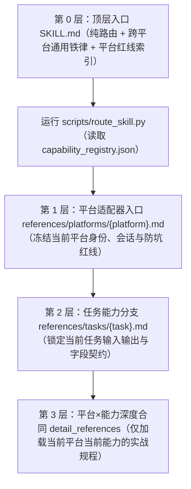

# 多平台商品运营自动化 v1.7.4（三级按需加载架构）

本文件是**第 0 层顶层路由与跨平台通用铁律入口**。
为彻底杜绝跨平台规则混淆、字典串用或遗漏平台专属防坑红线，所有任务必须严格按 **“先定平台 ➔ 再定已实现能力 ➔ 按 `load_order` 按需加载专属合同”** 的三级金字塔架构执行。不要预读无关平台的 `references/`，也严禁把 A 平台的登录态、签名、请求、字典 ID、writer 或回读器用于 B 平台。

---

## 一、三级按需加载路由（第 1 步必跑）

收到任务后，首先运行轻量路由器获取本次任务唯一所需的 `load_order` 文件清单：

```bash
python3 scripts/route_skill.py \
  --request-text "$REQUEST_SUMMARY" \
  ${CURRENT_PAGE_URL:+--page-url "$CURRENT_PAGE_URL"} \
  --intent auto
```

### 三级渐进加载层级图



1. **严格按序按需读取**：只读取路由器返回的 `load_order` 文件（依次为：`references/platforms/{platform}.md` ➔ `references/tasks/{task}.md` ➔ 当前能力的 `detail_references`）；无关平台的参考文档一律不加载。
2. **能力状态强约束**：
   - `implemented`：包内已有生产执行器，但**必须**通过当前身份校验、写前快照、**首单金丝雀（Canary）独立回读验真**与完成门；
   - `runtime_guided`：必须先从当前页面 Network/运行时确认真实端点与载荷，再过首单 Canary 与独立回读；
   - `planned`：无生产 writer，**固定零写入**。
3. **消歧规则**：若返回 `ambiguous_platform` 或 `ambiguous_task`，先结合当前浏览器打开页面与上下文消歧；仍不唯一时向用户确认。

---

## 二、六大平台一级入口与致命红线速览（按当前平台对号入座）

| 平台标识 | 识别域名/特征 | 第 1 层平台入口 | 已实现/引导能力与第 3 层深度合同（按需加载） | 平台最高致命红线（严禁违背） |
| :--- | :--- | :--- | :--- | :--- |
| **翱象 (`aoxiang`)** | `saas-retail.ele.me` / `tc-supply-chain-portal.ele.me` | [`platforms/aoxiang.md`](references/platforms/aoxiang.md) | • 渠道属性/不符合渠道规则 (`implemented`)：[`aoxiang-channel-contract-v1.md`](references/aoxiang-channel-contract-v1.md) + [`aoxiang-playbook-and-pitfalls.md`](references/platforms/aoxiang-playbook-and-pitfalls.md)<br>• 商品改名/编辑 (`implemented`)：[`aoxiang-playbook-and-pitfalls.md`](references/platforms/aoxiang-playbook-and-pitfalls.md)<br>• 资质图治理 (`implemented`)：[`aoxiang-playbook-and-pitfalls.md`](references/platforms/aoxiang-playbook-and-pitfalls.md) | **多规格防覆盖四道代码级硬门禁**：<br>① 改前调 `warehouse/listAll` + `pageV3` 备份**全部门店与实体仓**子规格库存与独立库位；<br>② **100% 无条件调 `relation/detail`**（严禁用 `goodsType === 1` 或 `code.startsWith('@')` 过滤，因纯数字子规格调 `master/detail` 返回 `goodsType` 恒为 `0`！接口报错必须 `throw` 熔断，严禁 `catch { return null }` 静默降级）；<br>③ 发送 `master/update` 前执行 `assertMultiSpecSafe` 断言 `payload.skus.length >= expectedSkuCount`，违者抛 `FATAL_MULTI_SPEC_DOWNGRADE_BLOCKED`；<br>④ 剥离 `stockNum / cabinetCodeList / storeGoodsCustomFields / sourceStoreCode / extendsAttributes` 并设 `skipPublishStore: true`，首单多规格 Canary 回读无损后方才拉起 12~14 路并发。 |
| **牵牛花 (`qnh`)** | `qnh.meituan.com` / `/qnh-gw3/` | [`platforms/qnh.md`](references/platforms/qnh.md) | • 渠道类目与属性 (`implemented`)：[`channel-attribute-contract-v2.md`](references/channel-attribute-contract-v2.md)<br>• 不可售一次过 (`implemented`)：[`run-contract-541.md`](references/run-contract-541.md) + [`error-playbook.md`](references/error-playbook.md)<br>• 资质图 (`implemented`)：[`qualification-image-policy.md`](references/qualification-image-policy.md)<br>• 总部零售价补齐 (`runtime_guided`)：[`qnh-headquarters-price-fill.md`](references/tasks/qnh-headquarters-price-fill.md)<br>• 水印扫描/搬品重试/冲突复核/旧新SKU替换 | **🔴 门店自定义隔离与六大防覆写硬红线**：<br>① **严禁把门店自定义改为跟随总部**：同一 SPU/SKU 在不同门店可代表不同商品（`customizedNameFlag: true` / `customizedPicFlag: true`）；**严禁传 `customizedNameFlag: false` / `customizedPicUrlListFlag: false`**，**严禁在主档 `tenant/update/v2` 对含自定义门店的商品传 `field: 'spu_name'` 或 `'picture'` 的 `coverToStore: 1`（会触发 `主档级联更新` 静默抹平全店自定义！）**；有自定义的门店必须调 `/qnh-gw3/api/product/store/update` 按该门店当前自定义信息独立维护，仅无自定义门店跟随主档；<br>② **主图/详情图/特殊图原值保护**：永久禁用 `6f244c5f...` / `064b297f...` 等通用占位图及图库模糊搜图替换原主图；<br>③ **严禁跨品类改名/改类目（如便当盒）/改品牌（如海尔）规避资质拦截**；<br>④ **非调价任务价格零触碰（`storePrice`/`unifiedOnlinePrice`/`sellingPrice`）与上下架状态（禁止下架 `2` 改上架 `1`）100% 原值保护**；写前强制备份主档与全门店 `store/detail` 快照；<br>⑤ 先调 `batchRecommend` + `queryRecommendDynamicInfoAndWeight` 优先采纳官方推荐，再补齐剩余空白（0 空白）；产地字典：美团 `100000050`（`中国`），饿了么 `27772`（`中国大陆`）；满速架构：**4 Tabs 分布式 `H5guard.sign` + 12 Workers**。 |
| **美团直连 (`meituan`)** | `waimaie.meituan.com` / `shangoue.meituan.com` / `yiyao.meituan.com` | [`platforms/meituan.md`](references/platforms/meituan.md) | • 闪购不可售/影响流量 (`implemented`)：[`platform-meituan.md`](references/platform-meituan.md)（含 41 大治理规则）<br>• 调价推送 (`runtime_guided`)：[`meituan.md`](references/meituan.md)<br>• 商品编辑 (`runtime_guided`)：[`meituan-product-editing.md`](references/meituan-product-editing.md)<br>• 医疗器械整店迁移 (`runtime_guided`)：[`meituan-medical-device-store-migration.md`](references/meituan-medical-device-store-migration.md) | • 区分买药（`yiyao`）与闪购商品管家运行时；<br>• 闪购审核页必须带 `&oldVersion=true` 锁定 `webpackChunkpackage_detail`，注入随机 Chunk ID；<br>• 必须在视图模型 `e.normalAttributesValueMap` 上编辑（含被点名的 `required: false` 非必填项），经 `walle.g0(e)` 质检及 `_f / eN / z / Hq` 四段编译后提交 `ie.sI ➔ ie.L0 ➔ ie.$W`。 |
| **mini橙 (`minicheng`)** | `guodongcheng.cn` | [`platforms/minicheng.md`](references/platforms/minicheng.md) | • 渠道属性全量治理 (`implemented`)：[`minicheng-playbook-and-pitfalls.md`](references/platforms/minicheng-playbook-and-pitfalls.md) | • 修改前强制全量快照落盘（`artifacts/snapshots/minicheng_${storeCode}/`）；<br>• 遵循 Vue 双轨 Schema 绑定（`mtCatAttr` 数值化 `attrValueType` 匹配 `valueId`；`eleCatAttr` 字符串防 `null` 白屏与 `eleCatPropertyList` 同步）；<br>• 商品级销售单位 `skuList[i].unit` 与扩展属性单位双轨补齐，严禁裸数字。 |
| **饿了么直连 (`eleme`)** | `ele.me`（非翱象域名） | [`platforms/eleme.md`](references/platforms/eleme.md) | • 调价推送 (`runtime_guided`)：[`eleme.md`](references/eleme.md) | 按当前页面证据执行调价与独立回读，未实现能力保持零写入。 |
| **淘宝闪购 (`taobao_flash`)** | 淘宝闪购直连后台 | [`platforms/taobao-flash.md`](references/platforms/taobao-flash.md) | • 当前全部任务为 `planned` | 固定零写入，严禁借用牵牛花或翱象 writer。 |

---

## 三、跨平台共享核心铁律（所有平台通用，前后一致）

以下 5 条核心铁律适用于所有平台，各平台叶子合同在此基础上细化本平台字段格式：

1. **【铁律 1：首单金丝雀（Canary）独立回读门禁 ➔ 通过后立即拉满最高并发】**
   - **严禁未验真直接盲跑全量，也严禁 Canary 通过后还在单线程慢跑**：
     1. **第一步（写前快照 + 首单 Canary 必做）**：任何批量修改任务启动时，必须先完成写前快照备份，并**单独取 1 个代表性商品（若含多规格商品，必须选 1 个多规格商品）**执行更新与平台正式接口独立回读，验证目标字段生效且**多规格子 SKU 数量、价格、各门店库存、各子规格独立库位 100% 零丢失**；
     2. **第二步（Canary 通过后直接满速推进）**：首单 Canary 验证通过后，无需做 `1→2→4` 慢速阶梯试探，直接启用对应平台的最高稳定并发（牵牛花 `4 Tabs + 12 Workers`、翱象 `12~14 路 REST 并发`、美团直连 `常驻审核页内存并发`、mini橙 `8~12 Workers`）。

2. **【铁律 2：渠道属性全量 0 空白拉满与四级物化梯队（拒绝仅填必填、严禁反向优化）】**
   - **必填 + 非必填全量拉满**：无论是牵牛花、翱象还是 mini橙，**不仅要填必填项（`isRequired === 1` / `needFlag === 1`），所有非必填项（`isRequired === 2` / `needFlag === 0`）也必须按以下四级梯队全部回填，做到页面 0 空白**：
     - **第一梯队（平台官方“使用推荐”第一优先）**：优先调用平台官方推荐接口（牵牛花 `queryRecommendDynamicInfoAndWeight` / 翱象 `matchChannelCategoryPropertyV3` / mini橙 `aiRecommendCatAttr`）。只要官方推荐值非空且**不是伪推荐“其他/无品牌”**，100% 第一优先级采纳；若推荐值为 `"other/其他"`，严禁覆盖商品原有的真实品牌！
     - **第二梯队（原有真实非“其他”值 100% 保护与跨渠道继承）**：商品原本已填的真实品牌（如“联想”、“晨光”、“得力”）及合规属性必须 100% 保护，**严禁将正确品牌改错成“其他”**；同一商品在对端渠道已确认的等价事实同步转换继承。
     - **第三梯队（标题与规格语义精准提取）**：从商品名称与规格中提取品牌（支持 `"M＆G/晨光"` 等斜杠/括号全词段匹配）、包装方式、材质、供电/连接方式、数量与净含量（提取支数/个数时正则必须排除小数点后数字，防 `0.5mm` 误提为 `5支`）。
     - **第四梯队（Skill 规则库安全默认兜底）**：
       * **长度/线长/尺寸/传输距离/续航未明确标注时**：**一律默认填写 `0`（如 `0m` / `0cm`；若有 `minValue > 0` 则按 `minValue` 钳位），绝对禁止乱填 `100m` 等离谱数值**！
       * **数量/包数未明确标注时**：默认填写 `1`（带对应单位）。
       * **形状/适用场景/适用人群未明确时**：优先选 `通用` / `常规` / `日常` / `成人`。
       * **其余普通下拉未明确时**：第一顺位选 `其他` / `其它`，第二顺位选 `通用 / 常规 / 普通 / 标准`，第三顺位选合理基础项（如喇叭选 `单喇叭/双喇叭`，严禁盲选 `十一喇叭`；特殊化妆品选 `否/非特殊化妆品`）。

3. **【铁律 3：赠品与礼赠包装全量默认否定契约（规则 35）】**
   - **绝不向消费者承诺任何额外赠品**：凡涉及 `提供礼赠包装 / 赠品 / 是否赠送吸管/开瓶器/餐具 / 附赠` 等属性，**强制选定明确否定项（`普通包装 / 无礼袋 / 无赠品 / 不赠送 / 无 / 否`）**；若候选项全部为肯定赠送含义，一律保持留空 `[]` 不选。

4. **【铁律 4：门店自定义隔离、主图/价格/条码/上下架与多规格库存库位原值保护】**
   - **门店自定义隔离铁律（严禁强制改为跟随总部）**：当平台支持门店级自定义信息（如牵牛花 `customizedNameFlag` / `customizedPicFlag`）时，同一主档 SPU/SKU 在不同门店可能拥有独立的商品名称、商品主图、门店分类甚至指代不同品牌/款式的实物商品。**绝对严禁将门店自定义强制改为“跟随总部”（如传 `customizedNameFlag: false` / `customizedPicUrlListFlag: false`），也绝对严禁在总部主档通过全店级联覆盖（如 `field: 'spu_name' / 'picture', coverToStore: 1`）抹平门店自定义**！凡存在门店自定义的门店，必须以门店为单位按其当前自定义信息独立维护；仅未开启自定义的门店继承总部主档。
   - **图片、价格、上下架、类目品牌与多规格原值保护**：
     * **图片原值保护**：100% 保留原有主图、详情图与特殊图；严禁塞入通用“温馨提示/售后说明”占位图（如 `6f244c5f...` / `064b297f...`）或用图库模糊匹配图替换商家实拍主图；
     * **价格零触碰**：非调价任务严禁改动任何价格字段（主档 `sellingPrice`、门店 `storePrice`、`unifiedOnlinePrice`、`channelOnlinePriceList`）；
     * **上下架与渠道状态保护**：严禁将原本已下架（`2`）的商品改为上架（`1`），严禁将已发布渠道置为 `-1` 删除；
     * **禁止跨品类改名/改类目/改品牌规避拦截**：遇到经营资质/禁售/证照拦截时，严禁将类目篡改为“便当盒/保温杯”或将品牌篡改为“海尔”，必须原样保留商品信息并转 `manual_block`；
     * **条码与多规格库位保护**：非条码纠错场景 100% 保留原条形码；修改主档时严禁覆写或清空多规格子 SKU、门店库存与各子规格独立库位。

5. **【铁律 5：生图成本控制与法定证照真实性边界】**
   - 法定证照、3C 编号、医疗器械注册证、特殊化妆品批准文号严禁凭空编造；
   - 外部商业大模型生图 API 每次调用均产生成本，遵循单商品同物理类别幂等复用与跨渠道双向挂载；当用户明确要求“图片不需要生成”或纯属性填充任务（`channel_attributes_only`）时，外部生图预算固定为 `0`。

---

## 四、浏览器反风控启动与 Chrome 扩展 RPA 规范

### 1. 浏览器启动四大红线（彻底解决“禁止登录 / 请求异常 121056 / 滑块拦截”）
- 🔴 **红线 1**：绝对严禁添加 `--enable-automation` 参数；
- 🟢 **红线 2**：必须显式添加 `--disable-blink-features=AutomationControlled`；
- 🟢 **红线 3**：优先直接依附（Attach）用户已打开的常规 Chrome 实例，或使用独立持久化 `--user-data-dir` 启动（检查 `9222` ➔ `9223` ➔ `9224` 空闲端口）；
- 🟢 **红线 4**：若浏览器已被受控拉起，必须在加载前注入 `delete Object.getPrototypeOf(navigator).webdriver` 并刷新。
- **快捷启动命令**：`bash scripts/start_test_browser.sh --url "<目标URL>" --cdp-port 9222`。

### 2. Chrome 扩展开发与 SaaS 逆向注入五原则
1. **MAIN World 原生请求**：敏感业务接口必须在 `world: "MAIN"` 页面上下文中发起，严禁从隔离 Content Script 直接 `fetch` 暴露 `Origin: chrome-extension://...` 触发 403；
2. **React Fiber 状态提取**：优先从表格 `<tr>` 的 `__reactFiber$...` 向上回溯读取 `pendingProps.record`，避免纯 DOM 文本截断；
3. **共享仓与门店实体仓感知**：区分普通门店与共享实体仓（如牵牛花 `shareableWarehouseId`、翱象 `merchant/warehouse/listAll` 的 `warehouseCode`）；
4. **SPA 防重挂载**：注入 UI 节点绑定 `dataset.ydInjected = "1"` 防止重复叠加；
5. **CDP 热重载**：通过 CDP 连接存活端口进行无损探测与扩展刷新。

---

## 五、表格交付与不可破坏的共同约束

### 1. 表格交付规范
- 用户仅要求执行并汇报数量时，按实测回读证据简要汇报；用户指定自定义列格式（如指定 5 列修复日志或门店库存库位对比明细表）时，严格按用户当次要求的列结构交付。
- 用户要求标准运营报告时，严格遵循 [统一输出内容合同](references/core/output-contract.md) 与 [Excel 精确 Schema](references/excel-schema-v1.md)（`scripts/operations_workbook_schema.json` 固定 7 张表：`执行汇总`、`SPU清单`、`字段级审计`、`平台不存在`、`最终结构复核`、`问题与策略回灌`、`性能与外部调用统计`）。
- 所有商品 ID、SKU、SPU、条码、店内码一律按文本格式保存，严防科学计数法丢精度；导出文件若遇 Windows Excel 占用锁（`EBUSY`），自动切换备用文件名落盘并提示用户。

### 2. 不可破坏的共同约束
- **保存受理不等于完成**：`HTTP 200`、`success: true` 只是受理；只有平台独立回读（Detail + 列表 `pageV3`/`fetchList`）确认目标字段生效且非目标字段（多规格、价格、库存、库位）无损，才可宣告完成。
- **凭证安全**：Cookie、Token、Authorization、签名串严禁写入交付表格或公开日志。
- **故障与仓库维护按需加载**：遇到 403/429/超时才读取 [调试与阶梯放量](references/debugging-and-rollout.md)；维护或同步本 Skill 仓库时才读取 [仓库治理](references/repository-governance.md)（远端仅保留 `main` 分支，发布前运行 `quick_validate.py` 或全量单元与路由测试）。
