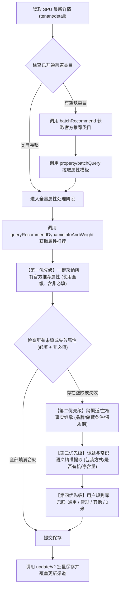

# 渠道类目与属性一体化执行合同 v4 (全量属性拉满·生产实战版)

## 适用范围与核心定位

当对牵牛花（QNH）平台的商品进行渠道优化时，本合同覆盖**已开通渠道的类目补齐、官方推荐属性全采纳、全量属性（必填 + 非必填）深度填充治理与历史失效值（幽灵属性）清洗**。

> [!IMPORTANT]
> **核心原则：只填写必填是不对的！必须全量填满（必填 + 非必填）**
> 牵牛花及美团/饿了么官方明确提示：“*所有必填属性需全部填写且准确，非必填项填写越多越有利于商品曝光*”。
> 仅填红星必填项会导致大量字段（如品牌、储藏条件、包装方式、是否有机等）留白，大幅降低商品在各渠道的权重与曝光率。
> **目标：所有渠道属性（`isRequired === 1` 必填 与 `isRequired === 2` 非必填）必须按梯队全部回填，做到页面 0 空白！**

---

## 生产实战关键勘误与核心原则

1. **原则升级：全量填满，拒绝仅填必填**
   * *旧认知*：只筛选和校验 `isRequired === 1` 的红星必填项，非必填全部忽略跳过。
   * *实战事实*：以饿了么为例，商品属性共 7 项，必填仅 3 项（产地、国产/进口、净含量），其余 4 项（储藏条件、是否有机、品牌、包装方式）均为非必填。若只填必填，页面留白过半，严重影响曝光与转化。
   * *修正*：**所有属性只要当前为空或失效，一律执行多梯队回填（官方推荐 ➔ 跨渠道/主档事实继承 ➔ 标题语义提取 ➔ 规则库兜底），做到 100% 填满**。

2. **修正：类目与属性一体化依赖**
   * *实战事实*：商品缺少渠道类目时，平台根本不会下发该渠道的属性结构。
   * *修正*：必须将**渠道类目检查与推荐补齐**作为第一前置步骤。

3. **修正：幽灵属性深度校验（历史失效值）**
   * *实战事实*：牵牛花类目升级后，历史选项 ID 已被淘汰，前台回显为“请选择”，同步报 401。
   * *修正*：通过 `isPropertyValid(prop)` 严格校验已有值是否命中当前候选库。失效值必须强制清除并重新物化。

4. **修正：执行效率与并发架构**
   * 复用已登录 Chrome 的 CDP 会话与 `window.H5guard.sign`，采用 **4 Tabs + 12 并发** 黄金比例，单件 ~2.3s 极速处理。

---

## 四阶段标准化全量执行流水线

处理每个 SPU 时，严格按以下先后顺序执行：

### 阶段 1：渠道类目检查与推荐补齐
* **适用范围**：仅对当前租户/商品**已开通且类目为空**的渠道处理。
* **接口**：`POST /qnh-gw5/api/v1/channelCategory/batchRecommend`
* **动作**：写入推荐类目（`categoryId`, `categoryName`, `idPath`, `namePath`），并调用 `batchQuery` 动态加载该类目对应的属性结构（`categoryProperties`）。

### 阶段 2：官方属性推荐全采纳（“使用全部”，含非必填）
* **定位**：最高优先级的属性填充源。
* **接口**：`POST /qnh-gw5/api/storeSpu/queryRecommendDynamicInfoAndWeight`
* **动作**：针对美团闪购（100）和饿了么（200），获取平台推荐的所有属性值（不论必填与否），**100% 优先采纳写入 `customValue`**。

### 阶段 3：全量属性（必填 + 非必填）深度填充与兜底
对所有 `customValue` 为空或属于失效旧值的属性（**包括 `isRequired === 1` 和 `isRequired === 2`**），按以下梯队逐级回填：

1. **跨渠道与主档事实继承**：
   * **品牌**：优先继承商品主档品牌（`detail.brand`）或美团已有的品牌名；
   * **储藏条件**：优先继承美团已有的储藏条件（如美团已填“常温”，饿了么匹配“常温”选项）；
   * **保质期**：饿了么/京东到家继承美团已有事实（如 `360天`，拆解为 sequence 1: 360，sequence 2: 天）；
   * **净含量/规格**：继承美团已有规格或从标题正则提取（如 `100g` 拆解为 sequence 1: 100, sequence 2: g）。

2. **标题与常识语义精准提取**：
   * **包装方式**：从商品标题匹配关键词（“真空包装” ➔ 真空包装；“袋装/袋” ➔ 袋装；“盒装/盒” ➔ 普通盒装；“礼盒” ➔ 礼盒装；“罐装” ➔ 罐装；“桶装” ➔ 桶装；“散装” ➔ 散装等）；
   * **是否有机**：标题或主档未明确标注“有机”的普通食品，单选精准匹配 **`非有机`**；若标注“有机”则选 **`有机`**；
   * **国产/进口**：标题未标注“进口/进口原装”的，默认单选匹配 **`国产`**。

3. **用户授权的安全默认规则库（User Rulebook 兜底）**：
   * **单选/多选/下拉**：
     - 优先选包含更多情况的安全选项：“其他”或包含“其他”字样；
     - 适用场景/形状等：选“通用”或“常规”；
     - 若均无，选候选列表第 1 项，确保不留白。
   * **品牌**：未明确时选“其他”（若无“其他”则兜底“无品牌”）。
   * **长度/尺寸**：未明确标注时，默认填写 **`0米`**（数值填写 `0`）。
   * **数量/包数**：从标题提取数字，未标注默认填写 **`1`**。
   * **文本长度保护**：自由文本严格截断至 `maxTextLength`。

### 阶段 4：增量保存与全渠道覆盖
* **接口**：`POST /qnh-gw3/api/product/tenant/update/v2`
* **覆盖声明**：在 `coverageRequest.fieldCoverageInfoList` 中覆盖更新的所有渠道：
  * 美团：`mt_channel_category_property`
  * 饿了么：`elm_channel_category_property`
  * 京东到家：`jd_channel_category_property`
* **完成判定**：以返回 `code === 0` 为准。

---

## 核心代码入口索引
* **规则引擎**：[`scripts/platforms/qnh/required_property_rules.mjs`](../scripts/platforms/qnh/required_property_rules.mjs)
* **全量执行器**：[`scripts/platforms/qnh/execute_mass_spu_cleaning.mjs`](../scripts/platforms/qnh/execute_mass_spu_cleaning.mjs)
* **单品验证器**：[`scripts/platforms/qnh/test_single_spu_update.mjs`](../scripts/platforms/qnh/test_single_spu_update.mjs)

