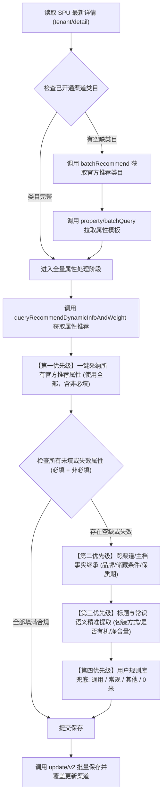

# 渠道类目与属性一体化执行合同 v5 (全量属性拉满·门店自定义隔离与原值保护版)

## 适用范围与核心定位

当对牵牛花（QNH）平台的商品进行渠道优化时，本合同覆盖**已开通渠道的类目补齐、官方推荐属性采纳、全量属性（必填 + 非必填）深度填充治理、历史失效值（幽灵属性）清洗，以及门店自定义商品（Store-SPU）隔离分流维护**。

> [!CAUTION]
> **最高致命红线：门店自定义隔离保护（严禁强制改为“跟随总部”或级联覆盖自定义门店）与图片/价格/上下架原值保护**
> 1. **严禁强制把门店自定义改为跟随总部**：在牵牛花中，同一主档 SPU/SKU 在不同门店可拥有独立的自定义名称（`customizedNameFlag: true`）、自定义主图（`customizedPicFlag: true` / `customizedPicUrlListFlag: true`）和自定义门店分类（`mainFrontCategoryList`），甚至在不同门店指代完全不同品牌/款式的商品。
>    - **绝对禁止**在门店更新接口 `POST /qnh-gw3/api/product/store/update` 中传 `customizedNameFlag: false` 或 `customizedPicUrlListFlag: false`（将自定义强制改为跟随总部）；
>    - **绝对禁止**在主档更新接口 `POST /qnh-gw3/api/product/tenant/update/v2` 中对含自定义门店的 SPU 传递 `{ field: 'spu_name', coverToStore: 1 }`、`{ field: 'product_name', coverToStore: 1 }`、`{ field: 'picture', coverToStore: 1 }` 或 `{ field: 'pic_url_list', coverToStore: 1 }`（牵牛花后台 `主档级联更新` 会无条件抹掉所有门店的自定义开关并用主档名称/图片覆盖全店！）；
>    - **分流维护铁律**：凡某门店开启了自定义（`customizedNameFlag: true` 或 `customizedPicFlag: true`），必须**单独以该门店为单位**调用 `POST /qnh-gw3/api/product/store/update`，显式保持 `customizedNameFlag: true`、`customizedPicUrlListFlag: true`，严格按照该门店当前自定义的名称、主图（`picInfoList`）、分类去维护该门店信息；仅未开启自定义的门店跟随总部主档维护。
> 2. **永久禁用通用占位图与模糊图库替换**：严禁使用原黑名单通用说明图（`6f244c5f3cb8b26399bbf31116c40de81422507.png`、`064b297f2dffbf5ad8d0e51e6f35cd5b1391479.png`）填充主图或详情图；严禁用 `query-pics-by-sku-name` 模糊搜图替换原有主图；严禁把 `pictureExample` 示例图写入特殊图槽位。
> 3. **严禁跨品类改名/改类目/改品牌规避资质拦截**：遇到医疗器械、成人用品、3C 或缺资质拦截时，严禁把类目篡改为 `便当盒 / 保温杯 / 厨房储物器皿` 或把品牌篡改为 `海尔`，必须原样保留商品信息并转 `manual_block`。
> 4. **价格与上下架状态 100% 原值保护**：非调价任务严禁改动任何价格字段（`storePrice` / `unifiedOnlinePrice` / `sellingPrice`）；严禁将原本已下架（`2`）的商品改为上架（`1`）或删除已发布渠道（`-1`）。

> [!IMPORTANT]
> **核心原则：只填写必填是不对的！必须全量填满（必填 + 非必填）**
> 牵牛花及美团/饿了么官方明确提示：“*所有必填属性需全部填写且准确，非必填项填写越多越有利于商品曝光*”。
> 仅填红星必填项会导致大量字段（如品牌、储藏条件、包装方式、是否有机等）留白，大幅降低商品在各渠道的权重与曝光率。
> **目标：所有渠道属性（`isRequired === 1` 必填 与 `isRequired === 2` 非必填）必须按梯队全部回填，做到页面 0 空白！**

---

## 生产实战关键勘误与核心原则

1. **原则升级：全量填满，拒绝仅填必填**
   * *旧认知*：只筛选和校验 `isRequired === 1` 的红星必填项，非必填全部忽略跳过。
   * *实战事实*：以饿了么为例，商品属性共 7 项，必填仅 3 项（产地、国产/进口、净含量），其余 4 项（储藏条件、是否有机、品牌、包装方式）均为非必填。若只填必填，页面留白过半，严重影响曝光与转化。
   * *修正*：**所有属性只要当前为空或失效，一律执行多梯队回填（官方推荐 ➔ 跨渠道/主档事实继承 ➔ 标题语义提取 ➔ 规则库兜底），做到 100% 填满**。

2. **修正：类目与属性一体化依赖**
   * *实战事实*：商品缺少渠道类目时，平台根本不会下发该渠道的属性结构。
   * *修正*：必须将**渠道类目检查与推荐补齐**作为第一前置步骤。

3. **修正：幽灵属性深度校验（历史失效值）**
   * *实战事实*：牵牛花类目升级后，历史选项 ID 已被淘汰，前台回显为“请选择”，同步报 401。
   * *修正*：通过 `isPropertyValid(prop)` 严格校验已有值是否命中当前候选库。失效值必须强制清除并重新物化。

4. **修正：执行效率与并发架构**
   * 复用已登录 Chrome 的 CDP 会话与 `window.H5guard.sign`，采用 **4 Tabs + 12 并发** 黄金比例，单件 ~2.3s 极速处理。

---

## 四阶段标准化全量执行流水线

处理每个 SPU 时，严格按以下先后顺序执行：

### 阶段 1：渠道类目检查、推荐与三级语义兜底
* **适用范围**：对当前租户/商品**已开通且类目为空**的渠道进行处理。
* **核心接口**：
  * `POST /qnh-gw5/api/v1/channelCategory/batchRecommend`（官方智能推荐）
  * `POST /qnh-gw5/api/v1/channelCategory/queryByChannelId`（饿了么全量 2,415 叶子类目树）
* **三级梯队类目挂载策略（严禁任何渠道类目留空）**：
  1. **第一梯队（官方算法推荐）**：传入标题与真实 UPC 调用 `batchRecommend`，命中则直接采纳；
  2. **第二梯队（标题降噪二次推荐）**：当官方推荐未返回（尤其饿了么渠道）时，剔除标题中的规格（如 `10片/包`、`189g/盒`）与营销噪音词（如 `便携装`、`温和无刺激`、`清洁杀菌`）后重新发起推荐；
  3. **第三梯队（跨渠道类目语义映射）**：当饿了么推荐仍为空（因饿了么类目库缺失细分末级类目），依据美团或京东已挂载类目进行跨渠道语义映射：
     - 美团/京东 `洗衣凝珠` ➔ 饿了么 `201220042 家庭清洁>衣物清洁/护理>洗衣液/内衣洗涤剂`
     - 美团/京东 `粉圆/芋圆/爆爆珠` / `其他烘焙材料` ➔ 饿了么 `201229643 调味品>烘焙辅料>生粉/蛋糕粉/预拌粉`
     - 美团/京东 `湿巾` / `卫生湿巾` ➔ 饿了么 `201220661 家庭清洁>纸品湿巾>湿纸巾`
  4. **第四梯队（全量叶子类目树倒排打分）**：基于饿了么 2,415 个末级类目全量库，结合商品名称与美团类目词进行倒排权重打分匹配，确保 100% 挂载对口类目。
* **铁律：新挂载类目后必须立即联动属性拉满**：
  * 严禁“只填写渠道类目而遗留属性空白”！
  * 渠道类目挂载后，必须立即调用 `batchQuery` 动态获取属性骨架（或拉取最新 `detail`），随后必须完整执行阶段 2（官方推荐）与阶段 3（0 空白兜底回填），将新挂载渠道的属性全部拉满并提交保存！

### 阶段 2：官方属性推荐全采纳（“使用全部”，含非必填）
* **定位**：最高优先级的属性填充源。
* **接口**：`POST /qnh-gw5/api/storeSpu/queryRecommendDynamicInfoAndWeight`
* **动作**：针对美团闪购（100）和饿了么（200），获取平台推荐的所有属性值（不论必填与否），**100% 优先采纳写入 `customValue`**。

### 阶段 3：全量属性（必填 + 非必填）深度填充与兜底
对所有 `customValue` 为空或属于失效旧值的属性（**包括 `isRequired === 1` 和 `isRequired === 2`**），按以下梯队逐级回填：

1. **跨渠道与主档事实继承**：
   * **品牌**：优先继承商品主档品牌（`detail.brand`）或美团已有的品牌名；
   * **储藏条件**：优先继承美团已有的储藏条件（如美团已填“常温”，饿了么匹配“常温”选项）；
   * **保质期**：饿了么/京东到家继承美团已有事实（如 `360天`，拆解为 sequence 1: 360，sequence 2: 天）；
   * **净含量/规格**：继承美团已有规格或从标题正则提取（如 `100g` 拆解为 sequence 1: 100, sequence 2: g）。

2. **标题与常识语义精准提取**：
   * **包装方式**：从商品标题匹配关键词（“真空包装” ➔ 真空包装；“袋装/袋” ➔ 袋装；“盒装/盒” ➔ 普通盒装；“礼盒” ➔ 礼盒装；“罐装” ➔ 罐装；“桶装” ➔ 桶装；“散装” ➔ 散装等）；
   * **是否有机**：标题或主档未明确标注“有机”的普通食品，单选精准匹配 **`非有机`**；若标注“有机”则选 **`有机`**；
   * **国产/进口**：标题未标注“进口/进口原装”的，默认单选匹配 **`国产`**。

3. **用户授权的安全默认规则库（User Rulebook 兜底）**：
   * **单选/多选/下拉**：
     - 优先选包含更多情况的安全选项：“其他”或包含“其他”字样；
     - 适用场景/形状等：选“通用”或“常规”；
     - 若均无，选候选列表第 1 项，确保不留白。
   * **产地/原产地（强字典约束，严禁无ID纯文本）**：
     - 饿了么（200）：饿了么产地为 `attrValueType: 4` 字典项，牵牛花服务端对无有效字典 ID 或字面不符的输入会静默丢弃。**必须精准写入字典 ID `27772`（名称 `中国大陆`）**；
     - 美团（100）：**必须精准写入字典 ID `100000050`（名称 `中国`）**。
   * **品牌**：未明确时选“其他”（若无“其他”则兜底“无品牌”）。
   * **长度/尺寸**：未明确标注时，默认填写 **`0米`**（数值填写 `0`）。
   * **数量/包数**：从标题提取数字，未标注默认填写 **`1`**。
   * **文本长度保护**：自由文本严格截断至 `maxTextLength`。

### 阶段 3.5：商品主图、详情图（picContentList）与特殊图原值保护铁律（严禁通用占位图与级联覆写）
* **原有图片 100% 保护**：
  * 商品原有的主图（主档 `picUrlList`、门店 `picInfoList`）、详情图（`picContentList`）及特殊图（`mtSpecialPictureList`、`elmSpecialPictureList`）必须 **100% 原样保留**，严禁清空、删减或替换。
  * **永久废止并拉黑通用占位图**：绝对禁止向 `picUrlList` 或 `picContentList` 注入任何通用服务说明/温馨提示图（尤其是已拉黑的 `6f244c5f3cb8b26399bbf31116c40de81422507.png` 与 `064b297f2dffbf5ad8d0e51e6f35cd5b1391479.png`）！
  * **严禁把平台示例图写入特殊图**：绝对禁止把 `pictureExample` 中的示例图 URL 当成商品资质图写入 `mtSpecialPictureList` 或 `elmSpecialPictureList`。
* **详情图为空时的唯一合规处理**：
  * 纯渠道属性填充任务（`channel_attributes_only`）默认不改动图片字段。
  * 若在不可售治理中因渠道报错确需补齐空的 `picContentList`，**唯一允许的做法是原样复用当前商品（或当前自定义门店商品）自身已有的主图 URL**；且**绝对禁止**在主档 `coverageRequest.fieldCoverageInfoList` 中传入 `{ field: 'picture', coverToStore: 1 }`（因为牵牛花的 `field: 'picture'` 会同时级联覆盖所有门店的 `picUrlList` 并强行关闭门店的 `customizedPicFlag: true`！）。

### 阶段 4：门店自定义分流与安全保存（独立回读验真）
* **写前全量快照（强制前置）**：
  * 修改任何主档或门店商品前，必须先将主档 `tenant/detail` 及关联门店的 `store/detail`（含完整 `picInfoList` URL 数组、`spuName`、`customizedNameFlag`、`customizedPicFlag`、`storeSkuList` 价格与上下架状态）完整落盘备份。
* **主档与自定义门店分流维护**：
  1. **纯渠道类目属性同步（不触碰名称与图片）**：
     * 接口：`POST /qnh-gw3/api/product/tenant/update/v2`
     * `coverageRequest.fieldCoverageInfoList` **严格仅限包含本次实际修改的渠道属性字段**：
       - 美团属性：`mt_channel_category_property`
       - 饿了么属性：`elm_channel_category_property`
       - 京东到家属性：`jd_channel_category_property`
     * **绝对禁止**在 `fieldCoverageInfoList` 中夹带 `{ field: 'spu_name', coverToStore: 1 }`、`{ field: 'product_name', coverToStore: 1 }`、`{ field: 'picture', coverToStore: 1 }` 或 `{ field: 'pic_url_list', coverToStore: 1 }`！
  2. **存在门店自定义的商品（`customizedNameFlag: true` 或 `customizedPicFlag: true`）**：
     * 当某个门店的商品开启了自定义名称或自定义图片（甚至与主档不是同一品牌/款式）时，严禁将其强制改为“跟随总部”！
     * 必须**单独以该门店为单位**调用 `POST /qnh-gw3/api/product/store/update` 进行维护：
       - 显式保留 `customizedNameFlag: true`、`customizedPicUrlListFlag: true`；
       - 严格按照该门店当前的自定义名称（`spuName`）、自定义主图（`picInfoList` 转换的 `picUrlList`）、自定义分类（`mainFrontCategoryList`）维护该门店商品信息；
       - 顶层请求体必须携带 `operateType: 2, actCheckType: 1, source: 2, adjustStock: { entityId: sd.storeId, entityType: sd.storeEntityType || 1, comment: 'WEB-门店商品详情调整库存', skuList: [] }`；
       - 100% 保持该门店各 SKU 原有的 `storePrice`、`unifiedOnlinePrice`、`channelOnlinePriceList`、`spuSaleStatus`、`saleStatus` 与 `onlineStatus` 不变。
* **完成判定**：`code === 0` 仅代表保存受理，必须经独立详情回读（主档 `tenant/detail` 及自定义门店 `store/detail`）确认目标属性生效且门店自定义名称、主图、价格、上下架状态 100% 无损，方可判定完成。

---

## 核心代码入口索引
* **规则引擎**：[`scripts/platforms/qnh/required_property_rules.mjs`](../scripts/platforms/qnh/required_property_rules.mjs)
* **全量执行器**：[`scripts/platforms/qnh/execute_mass_spu_cleaning.mjs`](../scripts/platforms/qnh/execute_mass_spu_cleaning.mjs)
* **单品验证器**：[`scripts/platforms/qnh/test_single_spu_update.mjs`](../scripts/platforms/qnh/test_single_spu_update.mjs)

