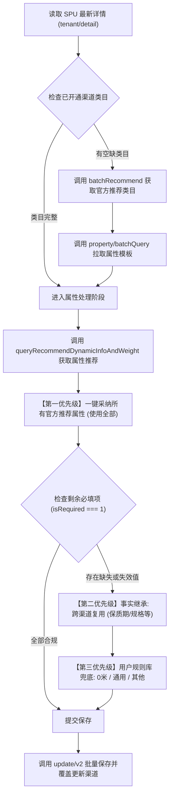

# 渠道类目与属性一体化执行合同 v3 (2000+ SPU 生产实战版)

## 适用范围与核心定位

当对牵牛花（QNH）平台的商品进行渠道优化时，本合同覆盖**已开通渠道的类目补齐、官方推荐属性全采纳、必填属性治理与历史失效值（幽灵属性）清洗**。
基于 2,423 个 SPU 的全量生产实践，类目与属性不可割裂：**渠道类目是属性的前置依赖，必须先确保已开通渠道的类目填写完整，再执行属性填充与保存**。

---

## 2000+ SPU 实战关键勘误与架构修正

1. **修正：类目与属性一体化依赖**
   * *旧认知*：仅单独治理“渠道类目属性”，假定类目均已存在。
   * *实战事实*：在 2,423 个商品中，多达 600 个商品缺少饿了么（200）或京东到家（300）的渠道类目。类目为空时，平台根本不会生成该渠道的属性结构，导致无法同步或报 401。
   * *修正*：必须将**渠道类目检查与推荐补齐**作为第一前置步骤。

2. **修正：执行效率与并发架构**
   * *旧认知*：单热 writer、逐商品打开编辑页（`run_qnh_batch.sh`），单进程最多 50 SPU。
   * *实战事实*：逐页打开编辑页单商品耗时 10~15 秒，2,400+ 商品需 8~10 小时，且易受 UI 动画与级联下拉卡顿影响。
   * *修正*：通过已登录 Chrome 的 CDP 会话，直接复用页面内 `window.H5guard.sign` 进行 Signed JSON API 调用，采用 **3 并发异步 Worker**。单商品耗时由 12s 降低至 **~300ms**，2,423 个 SPU 仅需 15 分钟即可 100% 成功完成，0 风控、0 降级、0 验证码。

3. **修正：幽灵属性深度校验（历史失效值）**
   * *旧认知*：只要 `customValue` 非空即视为合格。
   * *实战事实*：牵牛花类目升级后，历史选项 ID 已被淘汰，不再属于当前 `attrValueList`。前台回显为“请选择”，同步报 401。
   * *修正*：必须通过 `isPropertyValid(prop)` 严格校验已有值是否命中当前候选库。失效值必须强制清除并重新物化。

4. **修正：Node.js 进程退出机制**
   * *旧认知*：脚本执行完自然退出。
   * *实战事实*：Playwright `connectOverCDP` 会保持与 Chrome 的 WebSocket 长连接，导致 Node 事件循环永不退出，UI 后台任务永久显示 `running`。
   * *修正*：脚本必须在 `main().then(() => process.exit(0))` 中显式退出。

---

## 四阶段标准化执行流水线

处理每个 SPU 时，严格按以下先后顺序执行：

### 阶段 1：渠道类目检查与推荐补齐
* **适用范围**：仅对当前租户/商品**已开通且类目为空**的渠道处理（若账号未开通京东到家或饿了么，则不处理该渠道）。
* **接口**：`POST /qnh-gw5/api/v1/channelCategory/batchRecommend?yodaReady=h5&csecplatform=4&csecversion=4.3.0`
* **入参**：`{ channelIds: [100, 200, 300], spuUpcNameInfoVOS: [{ upc, name: spuName }] }`
* **动作**：将返回的推荐类目（`categoryId`, `categoryName`, `idPath`, `namePath`）写入渠道对象，并调用 `/qnh-gw5/api/v1/channelCategory/property/batchQuery` 动态加载该类目对应的属性结构（`categoryProperties`）。

### 阶段 2：官方属性推荐全采纳（“使用全部”）
* **定位**：最高优先级的属性填充源。
* **接口**：`POST /qnh-gw5/api/storeSpu/queryRecommendDynamicInfoAndWeight?yodaReady=h5&csecplatform=4&csecversion=4.3.0`
* **入参**：`{ spuName, channelId, channelCategoryId, upc }`
* **动作**：针对美团闪购（100）和饿了么（200），获取平台根据商品名称和条码推荐的所有属性值（如口味、含糖类型、包装方式、是否独立小包装、品牌等），**100% 优先采纳写入 `customValue`**。

### 阶段 3：剩余必填项与幽灵属性治理
在采纳完官方推荐后，对所有 `isRequired === 1` 且（值为空 或 属于失效历史候选）的属性，按以下梯队补充：
1. **跨渠道事实继承**：
   * 保质期：饿了么渠道继承美团已有事实（如 `360天`，拆解为 sequence 1: 360，sequence 2: 天）。
   * 规格/净含量：从商品标题/规格正则提取数值与单位（如 `182g` 组装为 sequence 1: 182, sequence 2: g）。
2. **用户授权的安全默认规则库（User Rulebook）**：
   * **原则 1（包容优先）**：优先选择包含更多情况且不会出错的选项，模糊时选“其他”。
   * **原则 2（长度/尺寸）**：未明确标注时，默认填写 **`0米`**（数值填写 `0`）。
   * **原则 3（形状/适用场景）**：未明确标注时，优先选择 **`通用`**。
   * **原则 4（品牌）**：未明确标注时，优先选择 **`其他`**（无“其他”则兜底“无品牌”）。
   * **文本长度保护**：自由文本严格截断至 `maxTextLength`。

### 阶段 4：增量保存与全渠道覆盖
* **接口**：`POST /qnh-gw3/api/product/tenant/update/v2?yodaReady=h5&csecplatform=4&csecversion=4.3.0`
* **覆盖声明**：在 `coverageRequest.fieldCoverageInfoList` 中覆盖更新的所有渠道：
  * 美团：`mt_channel_category_property`
  * 饿了么：`elm_channel_category_property`
  * 京东到家：`jd_channel_category_property`
* **完成判定**：以返回 `code === 0` 为准；发生异常时记录错误信息并继续处理下一个，不阻塞全局流水线。

---

## 核心代码入口索引
* **规则引擎**：[`scripts/platforms/qnh/required_property_rules.mjs`](../scripts/platforms/qnh/required_property_rules.mjs)
* **批量执行器**：[`scripts/platforms/qnh/execute_category_and_recommendation_cleaning.mjs`](../scripts/platforms/qnh/execute_category_and_recommendation_cleaning.mjs)
* **单品验证器**：[`scripts/platforms/qnh/test_channel_category_and_recommendation.mjs`](../scripts/platforms/qnh/test_channel_category_and_recommendation.mjs)
