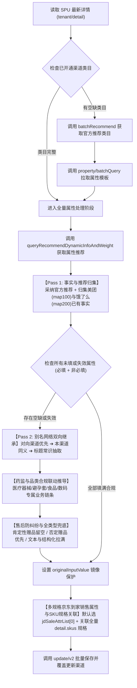

# 渠道类目与属性一体化执行合同 v6 (全量属性拉满·双通道两阶段继承·药械合规推导与售后避坑版)

## 适用范围与核心定位

当对牵牛花（QNH）平台的商品进行渠道优化时，本合同覆盖**已开通渠道的类目补齐、官方推荐属性采纳、全量属性（必填 + 非必填）深度填充治理、双通道两阶段事实继承与资质别名扩散、药监合规联动推导、非赠送售后避坑防御、历史失效值（幽灵属性）清洗，以及门店自定义商品（Store-SPU）隔离分流维护**。

> [!CAUTION]
> **最高致命红线：门店自定义隔离保护（严禁强制改为“跟随总部”或级联覆盖自定义门店）与图片/价格/上下架原值保护**
> 1. **严禁强制把门店自定义改为跟随总部**：在牵牛花中，同一主档 SPU/SKU 在不同门店可拥有独立的自定义名称（`customizedNameFlag: true`）、自定义主图（`customizedPicFlag: true` / `customizedPicUrlListFlag: true`）和自定义门店分类（`mainFrontCategoryList`），甚至在不同门店指代完全不同品牌/款式的商品。
>    - **绝对禁止**在门店更新接口 `POST /qnh-gw3/api/product/store/update` 中传 `customizedNameFlag: false` 或 `customizedPicUrlListFlag: false`（将自定义强制改为跟随总部）；
>    - **绝对禁止**在主档更新接口 `POST /qnh-gw3/api/product/tenant/update/v2` 中对含自定义门店的 SPU 传递 `{ field: 'spu_name', coverToStore: 1 }`、`{ field: 'product_name', coverToStore: 1 }`、`{ field: 'picture', coverToStore: 1 }` 或 `{ field: 'pic_url_list', coverToStore: 1 }`（牵牛花后台 `主档级联更新` 会无条件抹掉所有门店的自定义开关并用主档名称/图片覆盖全店！）；
>    - **分流维护铁律**：凡某门店开启了自定义（`customizedNameFlag: true` 或 `customizedPicFlag: true`），必须**单独以该门店为单位**调用 `POST /qnh-gw3/api/product/store/update`，显式保持 `customizedNameFlag: true`、`customizedPicUrlListFlag: true`，严格按照该门店当前自定义的名称、主图（`picInfoList`）、分类去维护该门店信息；仅未开启自定义的门店跟随总部主档维护。
> 2. **永久禁用通用占位图与模糊图库替换**：严禁使用原黑名单通用说明图（`6f244c5f3cb8b26399bbf31116c40de81422507.png`、`064b297f2dffbf5ad8d0e51e6f35cd5b1391479.png`）填充主图或详情图；严禁用 `query-pics-by-sku-name` 模糊搜图替换原有主图；严禁把 `pictureExample` 示例图写入特殊图槽位。
> 3. **严禁跨品类改名/改类目/改品牌规避资质拦截**：遇到医疗器械、成人用品、3C 或缺资质拦截时，严禁把类目篡改为 `便当盒 / 保温杯 / 厨房储物器皿` 或把品牌篡改为 `海尔`，必须原样保留商品信息并转 `manual_block`。
> 4. **价格与上下架状态 100% 原值保护**：非调价任务严禁改动任何价格字段（`storePrice` / `unifiedOnlinePrice` / `sellingPrice`）；严禁将原本已下架（`2`）的商品改为上架（`1`）或删除已发布渠道（`-1`）。

> [!IMPORTANT]
> **核心原则：只填写必填是不对的！必须全量填满（必填 + 非必填）**
> 牵牛花及美团/饿了么官方明确提示：“*所有必填属性需全部填写且准确，非必填项填写越多越有利于商品曝光*”。
> 仅填红星必填项会导致大量字段（如品牌、储藏条件、包装方式、是否有机等）留白，大幅降低商品在各渠道的权重与曝光率。
> **目标：所有渠道属性（`isRequired === 1` 必填 与 `isRequired === 2` 非必填）必须按梯队全部回填，做到页面 0 空白（除肯定性赠品承诺项主动留空防索赔外）！**

---

## 生产实战关键勘误与核心原则

1. **原则升级：全量填满，拒绝仅填必填**
   * *旧认知*：只筛选和校验 `isRequired === 1` 的红星必填项，非必填全部忽略跳过。
   * *实战事实*：以饿了么为例，商品属性共 7 项，必填仅 3 项（产地、国产/进口、净含量），其余 4 项（储藏条件、是否有机、品牌、包装方式）均为非必填。若只填必填，页面留白过半，严重影响曝光与转化。
   * *修正*：**所有属性只要当前为空或失效，一律执行多梯队回填（官方推荐 ➔ 跨渠道/主档事实继承 ➔ 标题语义提取 ➔ 规则库兜底），做到 100% 填满**。

2. **修正：类目与属性一体化依赖**
   * *实战事实*：商品缺少渠道类目时，平台根本不会下发该渠道的属性结构。
   * *修正*：必须将**渠道类目检查与推荐补齐**作为第一前置步骤。

3. **修正：幽灵属性深度校验（历史失效值）**
   * *实战事实*：牵牛花类目升级后，历史选项 ID 已被淘汰，前台回显为“请选择”，同步报 401。
   * *修正*：通过 `isPropertyValid(prop)` 严格校验已有值是否命中当前候选库。失效值必须强制清除并重新物化。

4. **修正：执行效率与并发架构**
   * 复用已登录 Chrome 的 CDP 会话与 `window.H5guard.sign`，采用 **4 Tabs + 12 并发** 黄金比例，单件 ~2.3s 极速处理。

5. **【v6 重大升级】双通道两阶段继承架构（Two-Pass Dual-Channel Pipeline）与资质别名网络**
   * *旧痛点*：单向顺序处理单渠道，导致美团已有微量真实数据（如 `注册证编号/备案凭证编号: 鲁械注准20162180063`），而饿了么因字段名为 `备案编号/注册证号`、`注册证号` 或 `产品技术要求编号` 无法命中，造成饿了么大面积空白（70% 留白）；且美团本渠道内的同义属性（如 `产品技术要求编号`、`注册证有效期`）也未能继承。
   * *实战修正*：
     - **Pass 1（双通道事实归集）**：并行扫描 SPU 美团（100）和饿了么（200）各自已有的真实数据与官方条码推荐，建立 `map100` 与 `map200` 事实字典；
     - **Pass 2（全网同构扩散与双向别名继承）**：引入监管资质别名网络（`ALIAS_GROUPS`），属性查找时遵循“先查对向渠道事实，再查本渠道同义已有事实”，实现“一处有真实证号，全网同构复用”，彻底避免凭空造假或多渠道数据冲突。

6. **【v6 重大升级】二类医疗器械（如避孕套/安全套）全链条药监合规推导**
   * **技术要求编号**：依据国家药监局规范，对于二类医疗器械，`产品技术要求编号` 原则上与 `医疗器械注册证编号`（如 `鲁械注准20162180063`）完全一致，双向继承；
   * **境内/进口与代理人判定**：以各省简称（如 `鲁/粤/浙/京/沪...械注准`）开头判定为境内国产器械，因此 `是否进口: 否` / `国产/进口: 国产`；境内器械无需外国代理人，故 `进口医疗器械代理人名称` 与 `代理人名称` 规范填入 **`不适用`**；
   * **材质与禁忌症强关联**：材质/标题为 `天然乳胶` 时，禁忌症联动推导行业金标准 **`乳胶过敏者禁用`**；
   * **分类与类别对应**：在饿了么的分类单选中，避孕套精确对应至国家二类标准：**`二类医疗器械`**；美团对应 **`避孕套`** / **`安全套`**；
   * **表面形态、体感与标称大小**：从标题提取 `超薄`（体感/薄厚）、`倍滑`（表面形态）、`52mm / 标准(宽度52±2mm)`（标称大小/尺寸）。

7. **【v6 重大升级】字符集元数据（`characterType`）的真实定义与符号脱敏清洗**
   * 牵牛花 `characterType` 的底层真实定义：
     - `1`: 中文汉字
     - `2`: 英文字母
     - `3`: 阿拉伯数字
     - `4`: 符号标点
   * **重大避坑**：`characterType: "1,2,3"` 允许中英数（仅禁止标点符号），**严禁误判为“仅英文代码”而强填信用代码**！只有属性名明确包含“统一社会信用代码”时才填入 `91110000000000000X`；普通的生产企业名称、储存条件、规格型号在 `1,2,3` 限制下正常填充中文，只需清洗去除 `（）()、，,。/*\-_\s` 等标点符号即可合规持久化；
   * `ct === "3"`（纯数字）：年份填 `2026`，3C证书填数字，数量填数字；
   * `ct === "3,4"`（数字与小数）：能量、碳水、钠等营养素填 `0`，功率填数字。

8. **【v6 重大升级】售后避坑与承诺赠品防御铁律（Dispute-Free Gift Guard）**
   * **商业红线**：“不要选要赠送的选项，有些不能用兜底值、会产生售后纠纷的不填”。
   * **两步执行法则**：
     - 步骤 1：遇到赠品/礼赠属性（`赠品`、`提供礼赠包装`、`是否配吸管`、`赠餐具` 等），优先选择否定项（`无赠品`、`普通包装`、`不支持礼盒包装`、`否`、`不赠`、`无吸管`、`无餐具` 等）；
     - 步骤 2：**若该属性所有候选全部为肯定承诺（如 `['赠勺子', '赠吸管']` 或 `['赠礼袋', '礼盒包装']`），坚决留空（不填）**！宁可留空，绝不能为了“拉满”而强制选择赠送项，避免消费者下单后因缺赠品发起索赔与投诉；
     - 步骤 3：**精准区分商品用途与赠品承诺**：商品本身的用途（如纸箱/飞机盒等包装用品的 `用途` 选项 `[送老师, 送爱人, 送朋友, 送客户]`）属于商品适用场景，并非附赠赠品，安全过滤时仅拦截 `送(?:吸管|勺子|杯子|礼品|配件|餐具|开瓶器|赠品|小样)` 等赠品承诺，正常放行商品用途。

9. **【v6 重大升级】全类型字段持久化硬契约（Field Durability via `originalInputValue`）**
   * 牵牛花 `update/v2` 接口对于自由文本（type 3）、自定义文本（type 4，`attrValueId: "0"`）、日期（type 8）、期限时长（type 9，`attrValueId: unitOption.optionId`）、无候选项的扩展单选（type 1/2，`attrValueId: "0"`），若仅赋值 `customValue`，更新接口返回 200 成功，但在后台独立回读时会被静默置空！
   * **必须同时同步赋值 `prop.originalInputValue = newValue`**，方可实现 100% 落地持久化！

10. **【v6.1 重大升级】多规格商品京东到家（`channelId=300`）销售属性选择与全规格关联保存铁律**
   * *历史漏项痛点*：过去在商品信息修复时，只补了京东到家渠道类目与京东品牌（`ch300.brandInfo`），漏掉了**多规格商品（`specType === 2` 或 `detail.skus.length > 1`）的京东到家销售属性（`ch300.saleAttrList`）与各 SKU 规格值关联（`sku.skuChannelInfoList` 中 `channelId === 300` 的 `saleAttrValueList`）**。一旦未设置京东到家销售属性，编辑页“销售属性”京东到家框下会报错 **`请至少选择1项`**，且多规格表格缺少京东到家销售属性列，导致**该商品完全无法推送到京东到家渠道**！
   * *真正业务成功的四步闭环*：
     1. **拉取当前京东三级类目的销售属性候选（`jdSaleAttrList`）**：调用 `POST /qnh-gw5/api/v1/channelCategory/property/batchQuery`，传入 `{ channelCategoryCodeMapV2: { "300": [{ channelCategoryId: String(ch300.categoryCode) }] } }`，从 `data["300"][0].jdSaleAttrList` 读取支持的销售属性列表（如 `[{ attrId: "1577293", attrName: "颜色" }, { attrId: "1577303", attrName: "尺码" }]`）；
     2. **默认选择第 1 个京东销售属性挂载到 SPU `ch300.saleAttrList`**：当 `ch300.saleAttrList` 为空（或原选属性不在新类目 `jdSaleAttrList` 支持范围内且尚未推送京东门店）时，**默认选择第 1 个属性 `firstAttr = jdSaleAttrList[0]`**（若已选且合法则沿用 `ch300.saleAttrList[0]`），写入：
        ```javascript
        ch300.saleAttrList = [{
          attrId: String(targetAttr.attrId),
          attrName: targetAttr.attrName,
          picRelated: false,
          saleAttrValueList: [],
          attrSortNum: 0,
        }];
        if (ch300.skuPicSetting === null || ch300.skuPicSetting === undefined) {
          ch300.skuPicSetting = 0;
        }
        ```
     3. **将全部 SKU 的规格值一一放进 `sci300.saleAttrValueList` 完成关联**：遍历 `detail.skus`（注意：`tenant/detail` 的规格列表字段为 `detail.skus`，规格名字段为 `sku.specName`；新增 SKU 的 `sku.skuChannelInfoList` 可能为 `null`，需先初始化为 `[]`）：
        - 提取规格名：优先取 `sku.specName`，次取美团渠道（`channelId === 100`）`saleAttrValueList` 的 `attrValue`；
        - 长度与去重保护：截断至 `<= 28` 字符（京东上限 30 字符），同 SPU 下若多个 SKU 规格文本重复则追加 `_${i + 1}`；
        - 对未关联（或 `attrId` 不匹配且未推送京东）的 SKU，在 `sku.skuChannelInfoList` 的 `channelId: 300` 节点写入：
          ```javascript
          sci300.saleAttrValueList = [{
            attrId: Number(targetAttr.attrId),
            attrName: targetAttr.attrName,
            attrValue: specText,
            attrValueId: null,
          }];
          ```
        - **已推送京东渠道存量 SKU 防报错边界**：若该 SPU 已推送到京东到家门店（`ch300.channelSpuList?.length > 0`），牵牛花服务端锁定存量已推送 SKU 的京东销售属性值（强改会报 `400 已经推送渠道的情况下，京东销售属性值不允许变更`），故对已有值的存量 SKU 保持原值不动。
     4. **携带 `jd_channel_category_property` 保存并独立回读验真**：在 `coverageRequest.fieldCoverageInfoList` 中包含 `{ field: "jd_channel_category_property", coverToStore: 1 }` 提交 `tenant/update/v2`，保存后通过 `tenant/detail` 独立回读确认 `ch300.saleAttrList` 与全部 SKU 的 `channelId=300` `saleAttrValueList` 均已持久生效，才算真正业务意义上的成功。

---

## 资质属性等价别名网络（Alias Equivalence Network）

多平台渠道属性名称各异，引擎内置以下等价映射组：

```javascript
export const ALIAS_GROUPS = [
  // 1. 核心监管与许可
  ['注册证编号/备案凭证编号', '备案编号/注册证号', '注册证号', '批准文号', '医疗器械注册证号', '化妆品备案编号/注册证号', '产品技术要求编号'],
  ['生产许可证编号', '生产许可证或者备案凭证编号', '化妆品生产许可证编号', '医疗器械生产许可证', '食品生产许可证编号', '生产企业生产许可证编号或备案编号', '医疗器械生产许可证/备案编号', '生产许可证'],
  ['产品标准号', '执行标准', '执行标准号'],
  ['3C认证证书编号', '3C证书编号', 'CCC证书编号'],

  // 2. 期限与日期
  ['有效期', '保质期', '注册证有效期', '保质期（天）', '保质期（月）'],

  // 3. 规格、形态与材质
  ['厚薄程度', '薄厚程度', '体感'],
  ['材质', '主体材质', '主要材质', '外身材质', '材质成分', '面料材质', '结构及组成', '器械结构与组成'],
  ['尺寸', '尺寸（mm）', '商品尺寸（长x宽x高mm）', '安全套 标称大小', '产品尺寸'],
  ['包装规格', '规格（型号）', '产品规格', '包装规格（只装）', '规格尺寸'],
  ['型号', '商品型号', '货号'],

  // 4. 企业主体与地址
  ['生产企业名称', '生产者（制造商）名称', '生产企业', '制造商名称', '厂家名称', '生产厂家名称', '注册人名称', '注册人或备案人信息'],
  ['生产厂家地址', '生产者（制造商）地址', '制造商地址', '厂家地址', '注册人住所', '代理人住所'],
  ['生产者（制造商）联系方式', '厂家联系方式', '制造商联系方式', '联系电话'],

  // 5. 功效、说明与条件
  ['适用范围', '功能', '功效', '核心功效', '主要功效', '功能特点', '特色功能'],
  ['说明书（安全使用特别说明）', '使用说明', '温馨提示', '注意事项', '食用提示'],
  ['禁忌症', '禁忌', '不适宜人群'],
  ['储存条件', '贮存条件', '储藏条件', '存储条件', '保存条件', '储藏方法', '贮藏'],
  ['国产/进口', '是否进口', '进口/国产', '国产或进口'],
  ['商品产地', '产地', '原产地'],

  // 6. 物理度量与包装
  ['单规格容量', '净含量', '单包净含量', '单件净含量', '总净含量', '单瓶净含量', '单罐净含量', '单袋净含量', '单盒净含量', '单支净含量', '商品净重（kg）', '产品净重（g）', '商品净重', '产品净重'],
  ['包装数量', '数量', '内含数量', '件数', '个数', '只数', '支数', '包数', '片数', '粒数', '电池节数', '单包片数', '单包抽数'],
  ['包装方式', '包装形式', '外包装形式', '包装种类', '包装类型'],
  ['口味', '风味'],
  ['香味', '香型', '气味'],
  ['适用人群', '适合人群', '适用对象', '使用人群'],
  ['适用肤质', '适合肤质'],
  ['适用发质', '适合发质'],
  ['适用场景', '使用场景'],
  ['适用季节', '适合季节', '季节'],
  ['是否含糖', '含糖类型', '糖分', '是否无糖', '含糖情况'],
  ['是否有机', '有机食品', '是否有机食品'],
  ['原麦汁浓度', '麦汁浓度', '麦汁浓度(°P)'],
  ['酒精度', '酒精度数', '酒精度(%vol)'],
  ['售卖方式', '销售方式'],
  ['接口', '接口类型', '数据线接口类型', '输出口类型', '电源端接口类型', '充电接口'],
  ['长度（m）', '线长', '线长（m）', '电源线长（m）', '数据线长度', '全长（m）', '长度'],
  ['额定功率（W）', '功率（W）', '单口最大输出功率（W）', '最大输出功率', '功率', '额定功率', '主流功率', '加热功率'],
  ['额定电压', '电压', '电压（V）'],
  ['电流', '电流（A）', '最大输出电流'],
  ['款式', '产品款式', '样式'],
  ['颜色', '色号', '颜色分类'],
  ['是否独立包装', '是否独立小包装', '独立包装'],
];
```

---

## 四阶段标准化全量执行流水线

处理每个 SPU 时，严格按以下先后顺序执行：



### 阶段 1：渠道类目检查、推荐与三级语义兜底
* **适用范围**：对当前租户/商品**已开通且类目为空**的渠道进行处理。
* **核心接口**：
  * `POST /qnh-gw5/api/v1/channelCategory/batchRecommend`（官方智能推荐）
  * `POST /qnh-gw5/api/v1/channelCategory/queryByChannelId`（饿了么全量 2,415 叶子类目树）
* **三级梯队类目挂载策略（严禁任何渠道类目留空）**：
  1. **第一梯队（官方算法推荐）**：传入标题与真实 UPC 调用 `batchRecommend`，命中则直接采纳；
  2. **第二梯队（标题降噪二次推荐）**：当官方推荐未返回（尤其饿了么渠道）时，剔除标题中的规格（如 `10片/包`、`189g/盒`）与营销噪音词（如 `便携装`、`温和无刺激`、`清洁杀菌`）后重新发起推荐；
  3. **第三梯队（跨渠道类目语义映射）**：依据美团或京东已挂载类目进行跨渠道语义映射；
  4. **第四梯队（全量叶子类目树倒排打分）**：基于饿了么 2,415 个末级类目全量库倒排打分匹配，确保 100% 挂载对口类目。

### 阶段 2：Pass 1 官方属性推荐与已有真实事实归集
* **定位**：最高优先级的属性填充源与跨渠道事实底册。
* **动作**：
  1. 提取商品美团（100）和饿了么（200）各自原本已有的有效自定义值，存入 `map100` 与 `map200`；
  2. 获取平台推荐的所有属性值（不论必填与否），**100% 优先采纳写入 `customValue`**，并同步更新到对应的渠道事实字典中。

### 阶段 3：Pass 2 别名网络双向继承、药监推导与全量兜底
对所有 `customValue` 为空或属于失效旧值的属性（**包括 `isRequired === 1` 和 `isRequired === 2`**），按以下梯队逐级回填：

1. **别名网络双向事实继承（Cross & Intra Alias Inheritance）**：
   * 优先查对向渠道（跨渠道事实，如饿了么继承美团的 `注册证号`、`品牌`、`储藏条件`、`保质期`、`净含量`）；
   * 次查本渠道已有事实（同渠道事实，如美团的 `产品技术要求编号` 继承本渠道已有的 `注册证编号/备案凭证编号`，`注册证有效期` 继承本渠道已有的 `有效期`）。

2. **标题与常识语义精准提取与药械品类业务链条**：
   * **二类医疗器械（避孕套/安全套）**：
     - `产品技术要求编号`：与 `注册证号` 统一；
     - `产地` / `国产/进口`：鲁/粤/浙/京...械注准识别为国产，`进口医疗器械代理人名称` 规范填 `不适用`；
     - `材质` 与 `禁忌症`：材质推导 `天然乳胶`，禁忌症联动填入 `乳胶过敏者禁用`；
     - `产品类别`：对应 `二类医疗器械`；
     - `尺寸/标称大小`：中号标准款 `52mm` 或 `标准(宽度52±2mm)`。
   * **普通快消/食品**：
     - `包装方式`：从标题提取关键词（袋装/盒装/罐装/桶装/散装等）；
     - `是否有机`：未明确标注“有机”默认单选 **`非有机`**；
     - `国产/进口`：未明确标注“进口”默认单选 **`国产`**。

3. **售后防纠纷与全类型兜底规则（Dispute-Free Safe Fallback）**：
   * **单选/多选/下拉（Type 1 / Type 2）**：
     - **赠品/礼赠属性**：优先选否定项（`无赠品`、`普通包装`、`否`、`不赠` 等）；**若候选全为肯定赠品项，坚决留空不填**！
     - **通用选项**：选“其他”或包含“其他”字样；场景/形状选“通用”或“常规”；
     - **末级兜底**：选 `opts[0]`（剔除含 `赠` 或 `礼盒` 承诺项）。
   * **字典项（Type 4 / Type 5 / Type 12）**：
     - 饿了么产地强制字典 ID **`27772`（`中国大陆`）**；
     - 美团产地强制字典 ID **`100000050`（`中国`）**；
     - 品牌未明确选“其他品牌”（饿了么 `29534`，美团 `1000001`）。
   * **自由文本（Type 3）**：
     - 生产企业名称：`${brand}商品生产企业`（`ct="1,2,3"` 清洗去除标点符号）；
     - 生产厂家地址/注册人住所：`中国境内`；
     - 统一社会信用代码：`91110000000000000X`；
     - 厂家联系方式：`4000000000`；
     - 许可证/执行标准/变更情况：`不适用`；
     - 使用说明/温馨提示：`请按商品说明正确使用`；
     - 自由文本截断至 `maxTextLength`。
   * **日期（Type 8）**：规范填入 `2028-08-08`，`attrValueId: "0"`。
   * **期限（Type 9）**：规范拆解为 `12` 与 `个月`，`attrValueId: unitOption.optionId`。
   * **结构值（Type 10）**：严格匹配 template sequence，数值根据 min/max 安全 clamp 保护。
   * **持久化保障**：所有 Type 1/2（无选项扩展）、3、4、8、9 字段，**必须同时同步设置 `prop.originalInputValue = newValue`**。

### 阶段 3.5：商品主图、详情图（picContentList）与特殊图原值保护铁律
* **原有图片 100% 保护**：严禁清空、删减或替换原有图片；
* **永久拉黑通用占位图**：绝对禁止注入 `6f244c5f...` / `064b297f...` 通用说明图；
* **严禁把平台示例图写入特殊图**：严禁将 `pictureExample` 写入特殊图；
* **详情图为空时的唯一合规处理**：纯渠道属性任务不改动图片；如需补齐，仅允许复用当前商品自身已有主图 URL，严禁在主档传入 `{ field: 'picture', coverToStore: 1 }`。

### 阶段 3.6：京东到家品牌（`brandInfo`）与多规格销售属性（`saleAttrList`）+ 全量 SKU 规格关联契约
* **京东品牌（`ch300.brandInfo`）补齐**：若 `ch300.brandInfo?.brandCode` 为空，优先通过 `/qnh-gw5/api/v1/channel/brand/search` 检索商品真实品牌名称，未命中时兜底填入 `{ clean: null, brandName: "无品牌", brandCode: "35247" }`。
* **多规格（`specType === 2` 或 `detail.skus.length > 1`）京东销售属性与规格值必关联**：
  1. 若商品为多规格且开通/存在京东到家渠道（`channelId === 300`），必须检查 `ch300.saleAttrList` 是否已选定销售属性，以及 `detail.skus` 中每个 SKU 的 `skuChannelInfoList`（`channelId === 300`）是否已关联 `saleAttrValueList`；
  2. 当 `ch300.saleAttrList` 为空时，通过 `POST /qnh-gw5/api/v1/channelCategory/property/batchQuery` 拉取 `data["300"][0].jdSaleAttrList`，**默认选择第 1 个属性**（`jdSaleAttrList[0]`，如 `颜色` / `尺码` / `规格`）写入 `ch300.saleAttrList`，并设 `ch300.skuPicSetting = 0`；
  3. 遍历 `detail.skus`，将每个 SKU 的规格名称（`sku.specName` 或美团渠道 `saleAttrValueList` 规格值，截断至 `<= 28` 字符并同 SPU 去重）填入该 SKU 的 `channelId === 300` `saleAttrValueList`：
     `[{ attrId: Number(targetAttr.attrId), attrName: targetAttr.attrName, attrValue: specText, attrValueId: null }]`；
  4. 同步将 `jd_channel_category_property` 加入 `coverageRequest.fieldCoverageInfoList`（`coverToStore: 1`）一并保存。

### 阶段 4：门店自定义分流与安全保存（独立回读验真）
* **写前全量快照（强制前置）**：写前将主档 `tenant/detail` 及各门店 `store/detail` 完整落盘备份；
* **主档与自定义门店分流维护**：
  1. **纯渠道类目属性同步（不触碰名称与图片）**：
     - 接口：`POST /qnh-gw3/api/product/tenant/update/v2`
     - `fieldCoverageInfoList` **严格仅限本次实际修改的属性**：`mt_channel_category_property`、`elm_channel_category_property`、`jd_channel_category_property`；
     - **严禁夹带** `{ field: 'spu_name', coverToStore: 1 }` 或 `{ field: 'picture', coverToStore: 1 }`！
  2. **存在门店自定义的商品（`customizedNameFlag: true` 或 `customizedPicFlag: true`）**：
     - 必须**按门店维度独立调用** `POST /qnh-gw3/api/product/store/update`，保持 `customizedNameFlag: true`、`customizedPicUrlListFlag: true`，按当前门店真实自定义维护。
* **完成判定**：必须经独立详情回读（`tenant/detail` / `store/detail`）确认目标属性生效、门店自定义无损，方可判定完成。

---

## 核心代码入口索引
* **规则引擎**：[`scripts/platforms/qnh/required_property_rules.mjs`](../scripts/platforms/qnh/required_property_rules.mjs)
* **全量执行器**：[`scripts/platforms/qnh/execute_mass_spu_cleaning.mjs`](../scripts/platforms/qnh/execute_mass_spu_cleaning.mjs)
* **单品验证器**：[`scripts/platforms/qnh/test_single_spu_update.mjs`](../scripts/platforms/qnh/test_single_spu_update.mjs)
